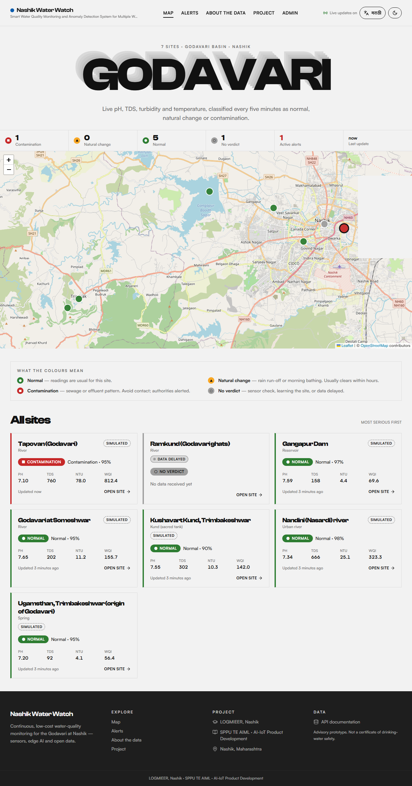
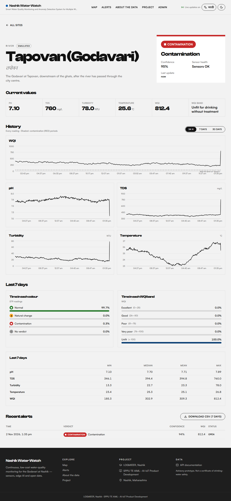
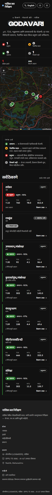
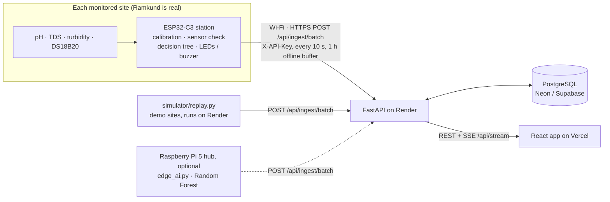

# Smart Water Quality Monitoring and Anomaly Detection System for Multiple Water Sources in Nashik

**SPPU TE AIML · AI-IoT Product Development · LOGMIEER, Nashik (2026–27)**
Team: Vishal Shivaji Patil · Bhagyashri Sadashiv Patil · Kavish Naveen Joshi — Guide: Prof. M. V. Raut

Low-cost probes measure pH, TDS, turbidity and temperature in the Godavari at Ramkund. A
Raspberry Pi classifies every site every 5 minutes as **Normal**, **Natural change**
(rain run-off, ritual bathing) or **Contamination** (sewage / effluent), checks that the
sensors are healthy, and publishes the result to a public bilingual (English / मराठी)
website with a live map, history charts and alerts. One site is a real sensor node; six
are clearly labelled **SIMULATED** virtual nodes.

| Map (live, desktop) | Site page | Phone · Marathi · dark |
|---|---|---|
|  |  |  |

## What is in this repository

```
backend/     FastAPI · SQLAlchemy 2 · Alembic · PostgreSQL — REST API, SSE, auth, alerts, retention
frontend/    React 18 · Vite · TypeScript · Tailwind · Leaflet · Recharts · i18next
simulator/   replay.py — the 6 virtual nodes (demo data) + viva event trigger
ml/          wqm_ml — synthetic data, features, sensor-health rules, training, model report
edge/        edge_ai.py — the Raspberry Pi 5 service (MQTT/serial -> AI -> website, offline queue)
firmware/    esp32c3_station (the field station) · Arduino UNO node, ESP8266 gateway, calibration sketch
docs/        STATION · ARCHITECTURE · API · DEPLOY · HARDWARE · screenshots
WQM_code/    the team's original assignment code (kept for reference)
```

## Architecture



The field design is one **ESP32-C3 station per water body** posting straight to the cloud;
adding a site means flashing one more station (see [docs/STATION.md](docs/STATION.md)).
The Arduino UNO + ESP8266 + Raspberry Pi path in `firmware/arduino_node`, `firmware/esp8266_gateway`
and `edge/` is kept as an alternative where a site needs the full Random Forest at the edge.

Every 5 minutes per site: 5-minute median window → sensor-health rules (GREY if a probe is
offline, stuck or out of range) → 24 features → Random Forest → GREEN / AMBER / RED, with
confidence. A RED record raises an alert (at most one per site per 30 minutes) and is pushed
to every open browser over Server-Sent Events.

## Run everything locally (no Docker)

You need **Node.js 20+** and **Python 3.11+** (3.13 works). Nothing else — the database is a
portable PostgreSQL that the scripts download into the project folder (`.devdb/`); no
installer and no admin rights.

```bash
npm run setup     # once: portable Postgres, backend/.venv, frontend packages, backend/.env
npm run dev       # every time: database + API + simulator + website in one terminal
```

| | URL |
|---|---|
| Website | http://localhost:5173 |
| API docs (Swagger) | http://localhost:8000/docs |
| Admin login | `admin@example.com` / `ChangeMe-dev-123` (set in `backend/.env`) |

`npm run dev` starts the database, applies the migrations (schema + the 7 seeded sites),
creates the admin user and ingest key, then runs the API, the simulator (48 h back-fill, then
a reading every 60 s) and the website — with coloured `[api]` `[sim]` `[web]` logs.
**Ctrl+C stops everything.** The map shows all 7 sites within seconds: 6 simulated with
colours, Ramkund GREY "data delayed" until the real node sends data.

**Viva demo** — in a second terminal while `npm run dev` is running:

```bash
npm run demo:contamination    # Tapovan turns RED on every open screen within seconds, one alert
npm run demo:rain             # Nandini turns AMBER
```

| Command | Does |
|---|---|
| `npm run dev -- --no-sim` | everything except the simulator (when the real Pi is posting) |
| `npm run dev -- --include-ramkund` | also simulate Ramkund (demo without hardware) |
| `npm test` | back-end, simulator and front-end tests against the local database |
| `npm run db:start` / `db:stop` / `db:status` / `db:reset` | manage the local database (`reset` deletes it) |

Prefer a cloud database? Put a Neon/Supabase connection string in `backend/.env`
(`DATABASE_URL=...`) and `npm run dev` uses it instead of the local one.

## API overview

Full request/response examples: [docs/API.md](docs/API.md). Interactive docs: `/docs`.

| Method | Path | Auth | Purpose |
|---|---|---|---|
| GET | `/api/health` | – | Status and database connectivity |
| GET | `/api/sources` | – | Active sites + latest reading + `stale` flag |
| GET | `/api/sources/{id}` | – | One site + latest reading |
| GET | `/api/sources/{id}/readings?hours=24\|168\|720` | – | Time series (raw ≤ 24 h, 15-min ≤ 7 d, hourly beyond) |
| GET | `/api/sources/{id}/stats?days=7` | – | Min / max / mean / median, time in each WQI band and colour |
| GET | `/api/alerts?limit=50&site=` | – | Recent alerts |
| GET | `/api/summary` | – | Counts by colour, active alerts, last update |
| GET | `/api/stream` | – | SSE: `reading` and `alert` events |
| GET | `/api/export/{id}.csv?days=7` | – | CSV download |
| POST | `/api/ingest` | `X-API-Key` | One status record from the Pi |
| POST | `/api/ingest/batch` | `X-API-Key` | Many records (offline queue), idempotent on (site, ts) |
| POST | `/api/auth/login`, `/api/auth/refresh` | – | JWT (access 30 min, refresh 7 days) |
| GET | `/api/auth/me` | JWT | Current user |
| GET/POST | `/api/admin/sites` | JWT admin | List / create sites |
| PUT/DELETE | `/api/admin/sites/{id}` | JWT admin | Edit / deactivate a site |
| POST | `/api/admin/alerts/{id}/ack` | JWT admin | Acknowledge with an optional note |
| GET/POST | `/api/admin/apikeys`, `/api/admin/apikeys/rotate` | JWT admin | List / rotate ingest keys |
| GET | `/api/admin/audit`, `/api/admin/ingest-health` | JWT admin | Audit log, messages per site per hour |

Rate limits: 60 requests/min per IP on public endpoints, 600/min on ingest, 10/min on login.

## Environment variables

Back end (`backend/.env.example`):

| Variable | Default | Notes |
|---|---|---|
| `DATABASE_URL` | local Postgres | `postgres://…` URLs from Neon/Supabase are accepted |
| `CORS_ORIGINS` | `http://localhost:5173` | Comma-separated front-end origins |
| `JWT_SECRET` | dev value | **Required** (≥ 32 chars) when `ENVIRONMENT=production` |
| `INGEST_API_KEY` | – | First ingest key; stored hashed; rotate later from the admin panel |
| `ADMIN_EMAIL`, `ADMIN_PASSWORD` | – | First admin user (created once) |
| `ACCESS_TOKEN_MINUTES`, `REFRESH_TOKEN_DAYS` | 30, 7 | |
| `RATE_LIMIT_PUBLIC`, `RATE_LIMIT_INGEST`, `RATE_LIMIT_LOGIN` | 60, 600, 10 per minute | |
| `STALE_AFTER_MINUTES`, `ALERT_DEDUP_MINUTES`, `RETENTION_DAYS` | 15, 30, 90 | |
| `RETENTION_TASK_ENABLED`, `RETENTION_INTERVAL_MINUTES` | true, 60 | Hourly roll-up + pruning inside the API |

Front end: `VITE_API_URL` (back-end URL, baked in at build time).
Simulator: `SIM_API_URL`, `SIM_API_KEY`, `SIM_INTERVAL`, `SIM_SPEED`, `SIM_BACKFILL_HOURS`.
Raspberry Pi (`edge/.env.example`): `WEB_API_URL`, `WEB_API_KEY`, `MQTT_HOST`, `NODE_SITE_MAP`, `TG_TOKEN`, `TG_CHAT`.

## The AI model

`ml/` trains on simulated data built from the team's field-test baselines and is evaluated on a
**separately generated test dataset** that was never used for training or tuning
([full report](ml/reports/REPORT.md)):

| | First version (`WQM_code`) | Now |
|---|---|---|
| Accuracy | 0.948 | **0.988** |
| Macro F1 | 0.897 | **0.971** |
| Contamination recall | 0.722 | **0.968** (precision 0.978) |
| Contamination events caught | 7 / 7 | **27 / 27**, mean delay 0.4 min |
| Arduino tree ALERT recall | 0.641 | **0.951** |

Re-train: `cd ml && pip install -r requirements-train.txt -e . && python -m wqm_ml.train`.
Results on simulated data show the method works; the real probe must be validated over
months of logging (see [docs/HARDWARE.md](docs/HARDWARE.md#8-validation-with-the-real-probe)).

## Working on one part at a time

```bash
npm run db:start                              # local database on localhost:5433
cd backend
.venv\Scripts\activate                        # macOS/Linux: source .venv/bin/activate
uvicorn app.main:app --reload                 # API only
pytest; ruff check .; black --check .         # back-end checks

cd frontend
npm run dev                                   # website only (expects the API on :8000)
npm run lint; npm test; npm run e2e           # front-end checks (e2e needs the API running)
```

## Tests and CI

GitHub Actions ([.github/workflows/ci.yml](.github/workflows/ci.yml)) runs on every push:
ruff + black + 87 pytest tests against PostgreSQL 16; ML/edge/simulator tests plus a quick
training run; ESLint + Prettier + type-check + 30 Vitest tests + production build; and a
Playwright end-to-end test (map shows 7 markers → open a site → charts) at desktop and 380 px.

## Deployment

Neon (database) → Render (back end, `render.yaml`) → Vercel (front end, `frontend/vercel.json`)
→ simulator → Raspberry Pi. Step by step: [docs/DEPLOY.md](docs/DEPLOY.md).
Hardware, wiring, calibration and Pi set-up: [docs/HARDWARE.md](docs/HARDWARE.md).

## Limitations

This system detects *changes* in water quality from 4 sensors. It does not test bacteria,
heavy metals or chemicals and is not a certificate that water is safe to drink. River water is
not meant for direct drinking. Simulated sites show computer-generated demonstration data.
