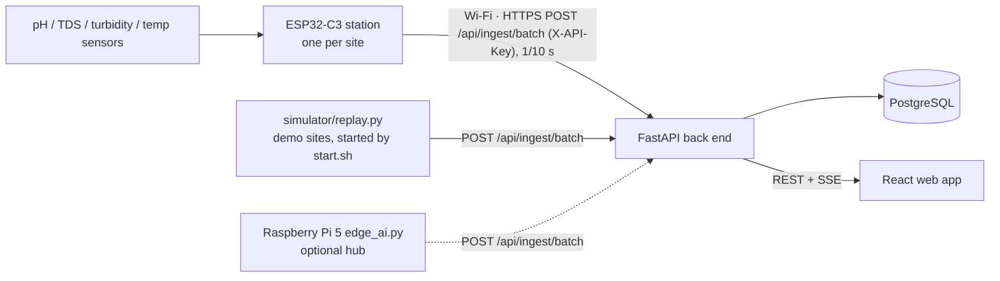

# Architecture notes

## Data flow

Stations make their own verdict (sensor check, then the decision tree exported by
`ml/wqm_ml/train.py`, or the BIS pH rule when only a pH probe is fitted) and send a complete
status record, so the API stays the same for stations, the Pi and the simulator. Ingest is
idempotent on (site, ts), so a station that resends a batch after a timeout never creates
duplicates. The simulator re-reads the site list every 5 minutes and stops posting for a
site as soon as an admin marks it as not simulated (a real station was installed).

## Back end

| Decision | Why |
|---|---|
| `readings` has `UNIQUE (site_id, ts)` and inserts use `ON CONFLICT DO NOTHING` | The Pi can re-send its offline queue safely. |
| Extra index `(site_id, ts DESC)` | "Latest reading per site" (`DISTINCT ON`) and range queries read it directly. |
| Sensor values are nullable | An `offline` record may carry no values; ranges are still enforced when present (API and `CHECK` constraints). |
| Vocabularies use `CHECK` constraints, not Postgres enums | Adding a value later is a one-line migration. |
| `readings_hourly` is a **table**, not a materialised view | A materialised view is recomputed from raw rows, so it would lose history once raw rows older than 90 days are pruned. The retention job upserts hours (last 3 days for late data, plus every hour about to be pruned) and then deletes raw rows. |
| Retention runs inside the API every hour, guarded by a Postgres advisory lock | Render's free tier has no cron; `python -m app.cli retention` runs it by hand. |
| Alert de-duplication takes a per-site advisory lock | Two simultaneous RED records can never both create an alert. The window is ±30 min, so out-of-order back-fill is handled too. |
| API keys stored as SHA-256 digests in `api_keys` | Keys are long random tokens, so a fast hash is safe and cheap enough for 600 req/min. |
| `INGEST_API_KEY` used only when `api_keys` is empty | A redeploy can never re-enable a key an admin rotated away. |
| JWT in the `Authorization` header (front end keeps it in `sessionStorage`) | No cookies, so no CSRF surface; tokens disappear when the tab closes. |
| All hourly truncation uses `date_trunc('hour', ts, 'UTC')` | Asia/Kolkata is UTC+05:30; a session-timezone truncation would split hours at :30. |
| Pure-ASGI logging middleware | `BaseHTTPMiddleware` interferes with long-lived SSE responses. |

## Live updates (SSE)

`/api/stream` sends `hello`, then `reading` (the site's new `SourceOut`) and `alert` events.
Ingest handlers run in the thread pool and hand events to the event loop with
`call_soon_threadsafe`; each client has a bounded queue (a slow client loses its oldest
events, never blocks others). The front end patches its cached site list in place, so a
marker changes colour without refetching; if the stream drops, queries poll every 60 s.

The API runs **one** Uvicorn worker so every SSE client shares the process that handled the
ingest. That comfortably handles this project's load (7 sites, a reading per site per minute).
Scaling out would need a shared channel such as Postgres `LISTEN/NOTIFY`.

## Machine learning (ml/ and edge/)

* One package, `wqm_ml`, holds the WQI, 5-minute windowing, the 24 features, the
  sensor-health rules and the decision rule. Training **and** the Pi import it, and a test
  checks that the Pi's streaming features equal the training features exactly.
* All features are causal (past data only). The first version's centred Hampel filter looked
  25 minutes into the future, which a live system cannot do.
* Labels mark an event only while its effect is ≥ 15 % of its peak.
* Train / validation / test are separate random realisations of all 7 sites. The
  contamination threshold (0.30) is tuned on validation with a precision floor of 0.90.
* scikit-learn is pinned (1.6.1) in both `ml/requirements.txt` and the Pi, because a pickled
  model is only guaranteed to load on the version that saved it.

## Front end design

The visual language follows the brief's Swiss / editorial system — Clash Display headlines
with the "echo" stack, Satoshi body text, monochrome `#f2f2f2 / #111111` surfaces, hairline
borders, pill buttons that invert on hover, a dark footer — with two deliberate changes for a
public-information site:

* **One water-blue accent** (`#0b5cad`, `#78b8ff` in dark mode) for links and focus, as the
  spec asks for a water-blue government-portal feel.
* **WCAG AA**: body grey darkened from `#838282` (3.4 : 1) to `#6b6a6a` (5.0 : 1). Status
  colours are fixed by the spec and always appear with a text label and a distinct glyph
  (● ▲ ■ ○), never colour alone.
* **Marathi**: Clash Display and Satoshi have no Devanagari, so Mukta is the fallback, and
  Devanagari headings are never letter-spaced tighter (it breaks the headline bar).
