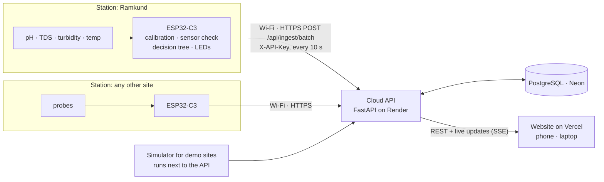

# ESP32-C3 sensor station: build one, install it, add it to the map

This is the project's field design: **one ESP32-C3 station per water body**, each talking
straight to the cloud over Wi-Fi. No Arduino, gateway, Raspberry Pi or PC in the data path.



What the station does:

| Every | What |
|---|---|
| 10 s | Reads each probe (median of 21 ADC samples), applies the calibration and temperature compensation, decides a colour, and POSTs one record over HTTPS. |
| 5 min | Takes the median of the window and, when pH + TDS + turbidity are all fitted, runs the decision tree (`WaterStateTree.h`, trained by `ml/wqm_ml/train.py`) on the same 6 features as the Arduino node: distance from the site's normal and the change over 15 minutes. |
| always | Keeps the last hour of readings in memory when Wi-Fi or the server is down and sends them as a batch later. The traffic-light LEDs and buzzer work with no network at all. |

Verdict on the station:

| Situation | Colour | Label |
|---|---|---|
| pH missing or outside 2–12 | GREY | Sensor check |
| pH + TDS + turbidity, tree warmed up (25 min after power-on) | tree output | Normal / Natural change / Contamination |
| otherwise, e.g. a pH probe only | GREEN if pH 6.5–8.5 (BIS IS 10500), else AMBER | Normal / Natural change (never RED from pH alone) |

## 1. Parts (one station)

ESP32-C3 Super Mini (or LOLIN C3 Mini) · pH probe + its signal board · TDS board ·
turbidity board · DS18B20 waterproof probe + 4.7 kΩ · 4 × 10 kΩ resistors (two dividers) ·
optional green/amber/red LEDs + 220 Ω and an active buzzer · USB-C 5 V supply or power bank ·
waterproof box + cable glands · pH 4.01 / 7.00 buffers for calibration.

## 2. Wiring

The ESP32-C3 reads at most about 2.5 V on an analog pin and runs at 3.3 V. Sensor boards
that need 5 V (pH, turbidity) can output more than that, so their output goes through a
**10 kΩ + 10 kΩ divider** (halves the voltage; the firmware multiplies it back with `DIV_PH`
and `DIV_TURB`).

| ESP32-C3 pin | Connects to | Notes |
|---|---|---|
| 5V (VBUS) | pH board V+, turbidity board VCC | 5 V from the USB-C supply |
| 3V3 | TDS board VCC, DS18B20 VDD (red) | |
| GND | every GND | one common ground |
| GPIO3 | pH board **Po / A** via divider | Po → 10 kΩ → GPIO3 → 10 kΩ → GND |
| GPIO1 | TDS board **A** | direct (0–2.3 V at 3.3 V supply) |
| GPIO0 | turbidity board **A** via divider | A → 10 kΩ → GPIO0 → 10 kΩ → GND |
| GPIO10 | DS18B20 data (yellow) | 4.7 kΩ from GPIO10 to 3V3 |
| GPIO5 / 6 / 7 | green / amber / red LED via 220 Ω (optional) | set `PIN_LED_*` in config.h |
| GPIO4 | active buzzer (optional) | set `PIN_BUZZER` |
| GPIO8 | on-board blue LED | blinks once per reading sent |

Rules for choosing other pins: analog inputs only on **GPIO0–GPIO4** (ADC1; ADC2 does not
work while Wi-Fi is on), and keep sensors off **GPIO2, GPIO8 and GPIO9** (boot pins).
A 100 nF capacitor from each analog pin to GND steadies the readings.

The pH and TDS probes disturb each other when they sit in the same small container (the TDS
probe drives a current through the water). In a river it is fine; for bench tests keep them
in separate cups or a few centimetres apart.

## 3. Flash the firmware (Arduino IDE 2)

Check the sensors first with `firmware/esp32c3_sensor_test/esp32c3_sensor_test.ino`: same
pins and formulas, no Wi-Fi. It prints each sensor's pin and board voltage once a second and
warns when a wire is loose or a pin voltage is too high (missing divider).

1. **File → Preferences → Additional boards manager URLs:**
   `https://espressif.github.io/arduino-esp32/package_esp32_index.json`
2. **Boards Manager:** install **esp32 by Espressif Systems** (3.x).
   **Library Manager:** install **OneWire** and **DallasTemperature**.
3. Open `firmware/esp32c3_station/esp32c3_station.ino`. In that folder, copy
   `config.example.h` to **`config.h`** and fill in:
   - `WIFI_SSID_1` / `WIFI_PASS_1` (2.4 GHz only; a phone hotspot works)
   - `API_KEY`: Render → nashik-water-api → Environment → `INGEST_API_KEY`
   - `SITE_ID`: the site this station is installed at, e.g. `ramkund`
   - `HAS_TDS`, `HAS_TURB`, `HAS_TEMP`: 1 for each probe you have connected
   `config.h` is git-ignored, so the password and key never reach GitHub.
4. **Tools:** Board **ESP32C3 Dev Module** (Super Mini) or **LOLIN C3 Mini** ·
   **USB CDC On Boot: Enabled** (otherwise the Serial Monitor stays empty) · Port: the
   board's COM port.
5. **Upload.** If it cannot connect, hold the **BOOT** button, plug the USB in, release,
   and upload again.
6. **Serial Monitor at 115200.** Expected:

   ```
   WQ station v3  site 'ramkund'  ->  https://nashik-water-api.onrender.com  every 10 s
   Sensors: pH
   Wi-Fi connected: MyHotspot  192.168.43.21  RSSI -58 dBm
   23:41:10  pH 7.31  ->  GREEN Normal  |  sent 1 (912 ms)  (queue 0)
   ```

   The Ramkund page on the website updates within a second of each "sent".

Status LED (blue, GPIO8): one short blink per reading sent · slow blink = no Wi-Fi ·
fast blink = API key rejected.

## 4. Calibrate

Type `cal` + Enter in the Serial Monitor. Posting pauses and the station prints the board
voltage of each probe every second. Type `run` to go back.

- **pH:** probe in the pH 7.00 buffer, wait 1 minute, write the volts into `PH_V7`; rinse,
  pH 4.01 buffer, write the volts into `PH_V4`. The defaults (2.00 V / 1.15 V) match boards
  that follow the common `pH = 3.5 × V` sketch.
- **TDS:** in a known standard solution, `TDS_K = known ÷ measured`.
- **Turbidity:** in clear RO/distilled water, write the volts into `TURB_VCLEAR`.

Upload again after editing `config.h`.

## 5. Add a station at a new place

1. **Website → Admin → Sites.**
   - New place: **Add site**. Enter an id in lower case with underscores (e.g. `godavari_bridge`),
     English and Marathi names, the type of water body and its latitude/longitude from Google
     Maps. **Untick Simulated** (it is ticked by default for new sites).
   - Replacing a demo site (e.g. Gangapur Dam): edit it and untick **Simulated**. The cloud
     simulator stops posting for it within 5 minutes and the badge changes to **LIVE**.
2. In the station's `config.h`: `SITE_ID` = that id, the Wi-Fi available at the place, and
   the site's baseline (`BASE_PH`, `BASE_TDS`, `BASE_TURB`, used by the tree; typical values
   for the seven sites are listed in config.example.h).
3. Flash, install, power on. The marker appears on the map with the first reading.

All stations share the one ingest key. **Admin → Rotate key** revokes it, so if you rotate it,
update `config.h` on every station and `INGEST_API_KEY` on Render (the cloud simulator uses it).

## 6. Installing at the water

- Electronics in a sealed box above the highest water level; probe cables through glands.
- Probes inside a perforated PVC pipe for protection, fully under water at the lowest level.
- Power: a 5 V USB-C adapter where mains is available, or a 10 000 mAh power bank (about a
  day at 10-second posting; set `READ_INTERVAL_S` to 60 for longer).
- Wi-Fi: the site's network, or a phone / 4G pocket router hotspot. If a Super Mini
  never joins, keep `WIFI_LOW_TX_POWER 1` (a known issue with that board's antenna).
- The pH probe's glass bulb must never dry out: store it in its storage solution when the
  station is removed. Re-calibrate pH every 2–4 weeks.

## 7. Troubleshooting

| Serial Monitor says | Fix |
|---|---|
| nothing at all | Tools → USB CDC On Boot: Enabled, upload again |
| `no Wi-Fi, queued` | check SSID/password, 2.4 GHz network, `WIFI_LOW_TX_POWER 1` |
| `API KEY REJECTED` | copy `INGEST_API_KEY` from Render again into `API_KEY` |
| `rejected 404` / `422` | `SITE_ID` does not exist on the website, or it is inactive: check Admin → Sites |
| `server -1 ...` for ~1 minute after a quiet period | the free Render server is waking up; the readings are kept and sent afterwards |
| `pH -` and GREY Sensor check | probe or divider not connected, or calibration far off: use `cal` |
