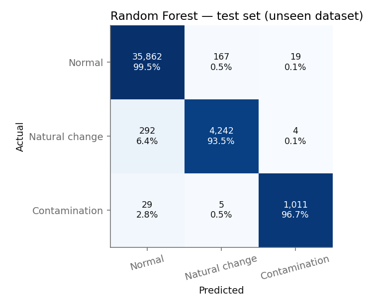
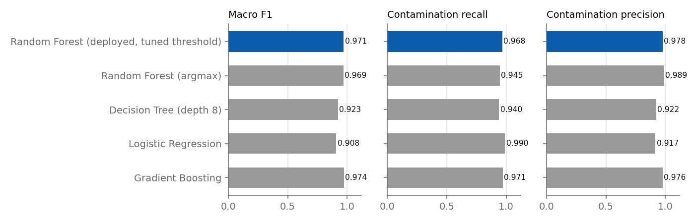
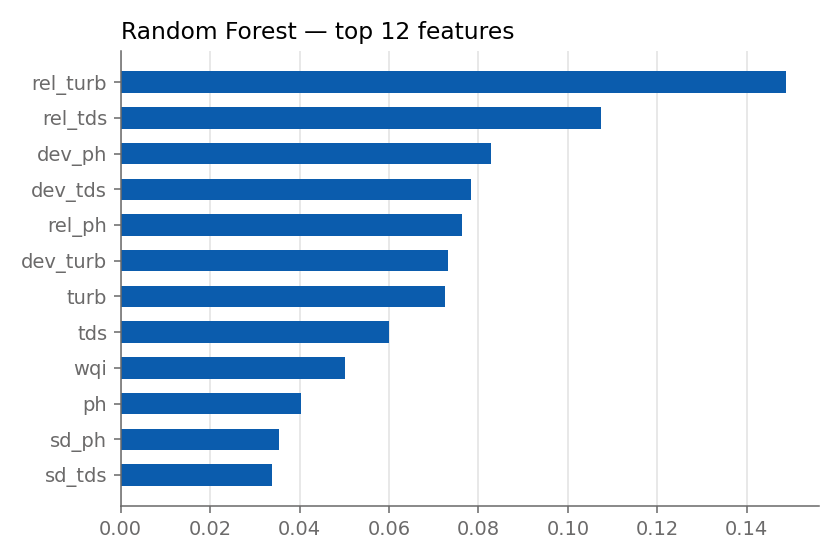
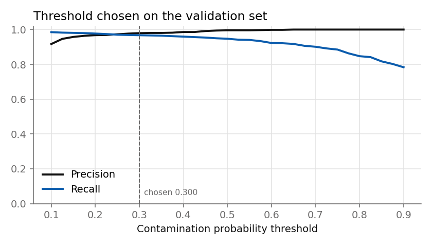

# Model report

Generated by `python -m wqm_ml.train` (wqm_ml 1.0.0, scikit-learn 1.6.1).
All numbers are on the **test dataset (seed 99)**, a fresh simulated realisation of all 7
sites that was never used for training or for choosing the threshold.

> These results are on simulated data built from the team's field-test baselines. They show
> the method works; performance on the real Ramkund probe must be confirmed with months of
> real logging (see docs/HARDWARE.md, "Validation").

## Deployed model: Random Forest + tuned contamination threshold

| Metric | Value |
|---|---|
| Accuracy | 0.988 |
| Macro F1 | 0.971 |
| Contamination precision | 0.978 |
| Contamination recall (5-min windows) | 0.968 |
| Contamination events caught | 27 of 27 (100.0%) |
| Detection delay (mean / median / max) | 0.4 / 0.0 / 5.0 min |
| False RED episodes | 3 (0.144 per site per week) |
| Contamination threshold (from validation set) | 0.3 |
| Mean confidence (correct / wrong) | 97.9% / 66.0% |
| Prediction latency, one window (this PC) | 42.3 ms |

Windows: train 125,232 · validation 41,898 · test 41,631.

### Per class

| Class | Precision | Recall | Test windows |
|---|---|---|---|
| Normal | 0.991 | 0.995 | 36,048 |
| Natural change | 0.961 | 0.935 | 4,538 |
| Contamination | 0.978 | 0.967 | 1,045 |

## Model comparison (same test set)

| Model | Accuracy | Macro F1 | Contam. precision | Contam. recall | Train (s) |
|---|---|---|---|---|---|
| Random Forest (deployed, tuned threshold) | 0.988 | 0.971 | 0.978 | 0.968 | 15.7 |
| Random Forest (argmax) | 0.987 | 0.969 | 0.989 | 0.945 | 15.7 |
| Decision Tree (depth 8) | 0.964 | 0.923 | 0.922 | 0.940 | 3.7 |
| Logistic Regression | 0.949 | 0.908 | 0.917 | 0.990 | 0.9 |
| Gradient Boosting | 0.989 | 0.974 | 0.976 | 0.971 | 3.0 |

## What changed from the first version (WQM_code/pi/analysis.py)

1. **Causal features.** The Hampel filter used a centred window (it looked 25 minutes into
   the future), which the Pi cannot do live. Windows are now the median of the 1-minute
   readings, and every feature uses past data only — training and the Pi compute identical values.
2. **Labels follow the water.** An event is labelled only while its signal is ≥ 15 % of its
   peak, not for a fixed 2-hour tail after it. The old tail labels asked the model to call
   already-clean water "Contamination", which capped recall around 0.72.
3. **Faster onset features** (`d1_*`, the 5-minute change) shorten the detection delay.
4. **Threshold tuned on a separate validation set** with a precision floor of 0.90, so
   recall rises without a flood of false RED alarms.
5. **Honest evaluation.** Test data is a different random realisation, and sensor-fault
   windows are removed (on the Pi they become GREY "Sensor check" before the model runs).

## Most important features

| Feature | Importance |
|---|---|
| `rel_turb` | 0.149 |
| `rel_tds` | 0.107 |
| `dev_ph` | 0.083 |
| `dev_tds` | 0.078 |
| `rel_ph` | 0.076 |
| `dev_turb` | 0.073 |
| `turb` | 0.072 |
| `tds` | 0.060 |

## Sensor-health rules (minute level, test set)

| Fault | Detected as | Precision | Recall | Minutes |
|---|---|---|---|---|
| dropout | offline | 0.958 | 0.958 | 767 |
| flatline | flatline | 0.998 | 0.895 | 1,653 |

Healthy minutes wrongly flagged: 0.026 %.

## Arduino UNO decision tree (offline local alerts)

Depth 5, 59 nodes, 8.2 KB header, features `rel_ph`, `rel_tds`, `rel_turb`, `d3_tds`, `d3_turb`, `d3_ph`.
Accuracy 0.899, macro F1 0.831, ALERT recall 0.951, ALERT precision 0.839.
Copy `ml/models/WaterStateTree.h` and `ml/models/SiteBaseline.h` into `firmware/arduino_node/`.
